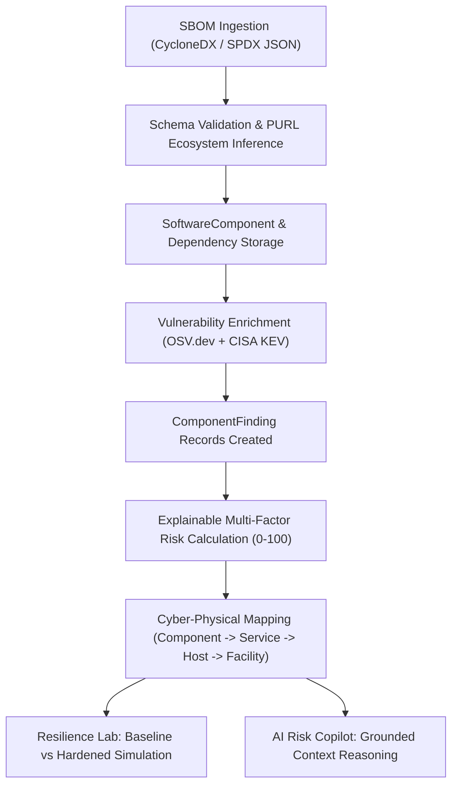

# System Architecture: CyberSecureChain & SupplyLens AI

**Student:** Rounak Singh (2430040169) | **Mentor:** Mr. Ravindra Kumar Saini  
**Institution:** Manipal University Jaipur  

---

## 1. High-Level Architectural Overview

CyberSecureChain integrates operational digital twinning, intrusion detection, and software supply chain intelligence into a unified three-tier architecture:

```
+-----------------------------------------------------------------------------------+
|                            Presentation Layer (SPA)                               |
|   React 19 + TypeScript + Vite + Zustand Store + React Router + Recharts + Leaflet|
|                                                                                   |
|   [ADMIN VIEW]                [CYBER VIEW]                [SUPPLYLENS AI VIEW]    |
|   - Facilities & Map          - Security Overview         - SL Overview & KPIs    |
|   - Inventory & Orders        - Live IDS ML Radar         - SBOM Ingestion (JSON) |
|   - Fleet GPS & Shipments     - Autonomous Red/Blue AI    - Component Inventory   |
|   - OT/IoT Machinery          - What-If Comparison        - Vulnerability Register|
|   - Unified Event Log         - SOAR Response Center      - Cyber-Physical Map    |
|                                                           - AI Risk Copilot       |
+-----------------------------------------------------------------------------------+
                                         |
                       REST API / WebSocket Streams (/ws/live)
                                         |
+-----------------------------------------------------------------------------------+
|                        Application Backend Services (FastAPI)                     |
|                                                                                   |
|   Digital Twin Engine         IDS ML & Traffic Gen         SupplyLens Intelligence|
|   - Facility / Inventory state - Random Forest (80 feats)   - CycloneDX / SPDX    |
|   - Order state transitions   - CIC-IDS2017 Live Feed      - OSV.dev / CISA KEV  |
|   - Atomic reservation        - Autonomous Adversary/SOAR  - Explainable Risk Eng|
|   - Non-destructive What-If   - WebSocket Manager          - Risk Copilot (No LLM)|
+-----------------------------------------------------------------------------------+
                                         |
                               SQLAlchemy 2.0 ORM
                                         |
+-----------------------------------------------------------------------------------+
|                            Persistence Layer (RDBMS)                              |
|           SQLite (Local Dev & Unit Tests) / PostgreSQL (Containerized)            |
|                                                                                   |
|   [Core Twin Tables]        [Cyber Resilience]          [SupplyLens AI Schema]    |
|   - facilities              - cyber_assets              - software_projects       |
|   - products & inventory    - security_controls         - sbom_import_jobs        |
|   - orders & shipments      - incidents                 - software_components     |
|   - vehicles & employees    - simulations               - component_findings      |
|   - operational_assets      - events                    - component_deployments   |
|                                                         - suppliers               |
|                                                         - risk_snapshots          |
|                                                         - mitigation_actions      |
+-----------------------------------------------------------------------------------+
```

---

## 2. SupplyLens AI Data Flow Pipeline

The software and supplier risk intelligence follows a clean, deterministic pipeline:



---

## 3. Threat Intelligence Ingestion & Resilient Offline Fallback

The vulnerability enrichment service integrates with public indexes with strict resiliency:
- **OSV.dev API (`https://api.osv.dev/v1/query`):** Queries open-source vulnerabilities using package name, version, and inferred ecosystem (`maven`, `pypi`, `npm`, `golang`).
- **In-Memory Caching:** 3600-second TTL prevents API rate limits and redundant remote calls.
- **CISA KEV Curated Index:** Direct local mapping for mission-critical supply-chain packages (Log4j, Spring Framework, Confluence, etc.).
- **Evidence Labeling:** All findings are tagged with their origin: `LIVE_OSV`, `CACHED_OSV`, `CISA_KEV`, or `SYNTHETIC_DEMO`.

---

## 4. Cyber-Physical Linkage Model

The core differentiator is the explicit modeling of software components to physical operations:

```
[SoftwareComponent] (e.g. log4j-core 2.14.1)
        │
        ▼ (deployed in)
[ComponentDeployment] (Service: WMS-PickPack-Service, Business Process: Order Fulfillment)
        │
        ▼ (runs on)
[CyberAsset] (SRV-WMS-01, IP: 10.0.1.15, Zone: IT-LOGISTICS)
        │
        ▼ (located at)
[Facility] (FC-DEL-01, Type: FULFILLMENT, City: Delhi)
        │
        ▼ (processes)
[Orders] (Customer Orders, Active Shipments, Inventory Reservations)
```

This causal dependency allows security analysts and evaluators to answer the critical question: *"If this software package is exploited via CVE-2021-44228, which physical shipments will be halted?"*
