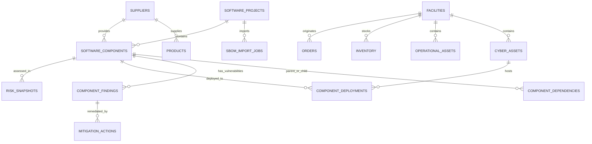

# SupplyLens AI Unified Data Model Specification

## 1. Overview
The SupplyLens AI data model seamlessly extends the existing CyberSecureChain schema without breaking existing tables or relations.

---

## 2. Table Specifications

### 2.1 `suppliers`
Extends product supplier strings to full vendor entities with security, criticality, and assessment tracking.
- `id`: INTEGER PRIMARY KEY
- `code`: VARCHAR(48) UNIQUE INDEX (e.g. `SUP-DEL-01`, `VND-001`)
- `name`: VARCHAR(160) NOT NULL
- `category`: VARCHAR(64) (e.g. `SOFTWARE`, `HARDWARE`, `LOGISTICS`, `CLOUD_INFRA`, `SERVICE`)
- `description`: TEXT
- `business_owner`: VARCHAR(120)
- `criticality`: INTEGER (1–10)
- `tier`: VARCHAR(20) (`TIER_1`, `TIER_2`, `TIER_3`)
- `assessment_status`: VARCHAR(32) (`ASSESSED`, `PENDING_REVIEW`, `INCOMPLETE`, `EXPIRED`)
- `contact_email`: VARCHAR(120)
- `last_assessment_date`: VARCHAR(40)
- `evidence_url`: VARCHAR(255)
- `data_sensitivity`: VARCHAR(32) (`LOW`, `MEDIUM`, `HIGH`, `RESTRICTED`)
- `risk_score`: INTEGER (0–100)
- `risk_level`: VARCHAR(20) (`LOW`, `MEDIUM`, `HIGH`, `CRITICAL`)
- `notes`: TEXT
- `created_at`: DATETIME

### 2.2 `software_projects`
Scope for ingested software applications (e.g. Warehouse Management System, Fleet Telemetry Gateway).
- `id`: INTEGER PRIMARY KEY
- `code`: VARCHAR(48) UNIQUE INDEX
- `name`: VARCHAR(160) NOT NULL
- `description`: TEXT
- `version`: VARCHAR(48)
- `repository_url`: VARCHAR(255)
- `business_owner`: VARCHAR(120)
- `facility_id`: INTEGER FOREIGN KEY -> `facilities.id` (nullable)
- `criticality`: INTEGER (1–10)
- `created_at`: DATETIME
- `updated_at`: DATETIME

### 2.3 `sbom_import_jobs`
Audit record of ingested SBOM files.
- `id`: INTEGER PRIMARY KEY
- `project_id`: INTEGER FOREIGN KEY -> `software_projects.id`
- `filename`: VARCHAR(255)
- `format`: VARCHAR(32) (`CYCLONEDX_JSON`, `SPDX_JSON`, `MANUAL`)
- `status`: VARCHAR(32) (`PENDING`, `PARSING`, `COMPLETED`, `FAILED`)
- `component_count`: INTEGER DEFAULT 0
- `relationship_count`: INTEGER DEFAULT 0
- `warnings`: JSON
- `error_message`: TEXT
- `created_at`: DATETIME

### 2.4 `software_components`
Parsed software packages and dependencies.
- `id`: INTEGER PRIMARY KEY
- `project_id`: INTEGER FOREIGN KEY -> `software_projects.id`
- `supplier_id`: INTEGER FOREIGN KEY -> `suppliers.id` (nullable)
- `name`: VARCHAR(160) NOT NULL INDEX
- `version`: VARCHAR(64) NOT NULL
- `ecosystem`: VARCHAR(48) (e.g. `npm`, `pypi`, `maven`, `golang`)
- `purl`: VARCHAR(255) INDEX (Package URL)
- `license`: VARCHAR(120)
- `direct`: BOOLEAN DEFAULT TRUE (Direct vs Transitive)
- `scope`: VARCHAR(32) (`runtime`, `development`, `optional`)
- `risk_score`: INTEGER DEFAULT 0 (0–100)
- `risk_level`: VARCHAR(20) (`LOW`, `MEDIUM`, `HIGH`, `CRITICAL`)
- `raw_metadata`: JSON
- `created_at`: DATETIME

### 2.5 `component_dependencies`
Parent-child directed graph edges.
- `id`: INTEGER PRIMARY KEY
- `project_id`: INTEGER FOREIGN KEY -> `software_projects.id`
- `parent_id`: INTEGER FOREIGN KEY -> `software_components.id`
- `child_id`: INTEGER FOREIGN KEY -> `software_components.id`
- `relationship_type`: VARCHAR(48) (`DEPENDS_ON`, `CONTAINS`, `DEVIATES_FROM`)

### 2.6 `component_findings`
Vulnerability intelligence findings (OSV, CISA KEV, NVD).
- `id`: INTEGER PRIMARY KEY
- `component_id`: INTEGER FOREIGN KEY -> `software_components.id`
- `vulnerability_id`: VARCHAR(64) NOT NULL INDEX (e.g. `CVE-2023-38606`, `GHSA-xxxx`)
- `source`: VARCHAR(48) (`OSV`, `CISA_KEV`, `NVD`, `SYNTHETIC_DEMO`)
- `severity`: VARCHAR(20) (`LOW`, `MEDIUM`, `HIGH`, `CRITICAL`)
- `cvss_score`: FLOAT (0.0–10.0, nullable)
- `cisa_kev`: BOOLEAN DEFAULT FALSE (Known Exploited Vulnerability)
- `summary`: TEXT
- `details`: TEXT
- `affected_versions`: VARCHAR(255)
- `fixed_version`: VARCHAR(64)
- `status`: VARCHAR(32) (`OPEN`, `IN_TRIAGE`, `MITIGATED`, `ACCEPTED`, `FALSE_POSITIVE`)
- `confidence`: VARCHAR(32) (`CONFIRMED`, `HIGH`, `MEDIUM`, `INFERRED`)
- `risk_score`: INTEGER DEFAULT 0 (0–100)
- `evidence`: JSON
- `created_at`: DATETIME

### 2.7 `component_deployments` (The Cyber-Physical Bridge)
Maps software components to physical operational nodes.
- `id`: INTEGER PRIMARY KEY
- `component_id`: INTEGER FOREIGN KEY -> `software_components.id`
- `service_name`: VARCHAR(120) NOT NULL
- `cyber_asset_id`: INTEGER FOREIGN KEY -> `cyber_assets.id` (nullable)
- `operational_asset_id`: INTEGER FOREIGN KEY -> `operational_assets.id` (nullable)
- `facility_id`: INTEGER FOREIGN KEY -> `facilities.id` (nullable)
- `business_process`: VARCHAR(160) (e.g. `Order Fulfillment`, `Fleet Dispatch`, `Inventory Control`)
- `mapping_type`: VARCHAR(32) (`VERIFIED`, `USER_MAPPED`, `INFERRED`, `SYNTHETIC`)
- `notes`: TEXT
- `created_at`: DATETIME

### 2.8 `risk_snapshots`
Audit log of deterministic risk calculations.
- `id`: INTEGER PRIMARY KEY
- `entity_type`: VARCHAR(32) (`PROJECT`, `COMPONENT`, `SUPPLIER`, `FINDING`)
- `entity_id`: INTEGER NOT NULL
- `risk_score`: INTEGER NOT NULL (0–100)
- `risk_level`: VARCHAR(20)
- `factor_breakdown`: JSON
- `available_factors`: JSON
- `missing_factors`: JSON
- `methodology_version`: VARCHAR(32)
- `rationale`: TEXT
- `created_at`: DATETIME

### 2.9 `mitigation_actions`
Remediation and resilience control decisions.
- `id`: INTEGER PRIMARY KEY
- `finding_id`: INTEGER FOREIGN KEY -> `component_findings.id` (nullable)
- `component_id`: INTEGER FOREIGN KEY -> `software_components.id` (nullable)
- `supplier_id`: INTEGER FOREIGN KEY -> `suppliers.id` (nullable)
- `title`: VARCHAR(160) NOT NULL
- `action_type`: VARCHAR(48) (`UPGRADE_VERSION`, `ISOLATE_SERVICE`, `COMPENSATING_CONTROL`, `WAF_RULE`, `SWITCH_SUPPLIER`)
- `status`: VARCHAR(32) (`PROPOSED`, `IN_PROGRESS`, `COMPLETED`, `VERIFIED`)
- `notes`: TEXT
- `created_at`: DATETIME
- `completed_at`: DATETIME (nullable)
